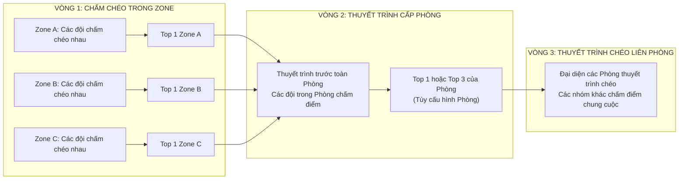

# 🏫 Đặc tả Mô hình Vận hành "AI Thực Chiến" (Multi-Room, Zone & Chấm Chéo 3 Giai Đoạn)

> **Dự án:** HackFlow — Nền tảng Quản lý & Thi đấu AI Thực Chiến  
> **Phạm vi:** Tổ chức đa lớp học / phòng thi theo ca, chia Zone trong phòng, cấu hình thời gian Checkpoint riêng theo phòng, và cơ chế chấm điểm chéo 3 giai đoạn giữa các đội thi.

---

## 1. Bối cảnh Vận hành Thực tế ("AI Thực Chiến")

Chương trình **AI Thực Chiến** được tổ chức cho nhiều lớp học / phòng thi (`Room`) bắt đầu ở các khung giờ khác nhau (ví dụ: Ca Sáng 08:00, Ca Chiều 13:30, Ca Tối 18:30...), với các đặc trưng cốt lõi:
1. **Dùng chung Đề thi & Tài nguyên Mentor:**
   - Tất cả các phòng đều truy cập chung một ngân hàng **Đề tài (`Topics` / `Subtopics`)**, kho tài nguyên dữ liệu mẫu (`Sample Data`, `Reference Docs`) và được hỗ trợ bởi cùng đội ngũ **Cố vấn chuyên môn (`Mentor`)** qua kênh Helpdesk Ticket.
2. **Độc lập về Quản lý Phòng & Khung giờ Checkpoint:**
   - Mỗi **Phòng (`Room`)** có số lượng học viên / đội thi khác nhau và do **Người quản lý phòng (`Room Manager` - thuộc vai trò Admin)** riêng trực tiếp điều phối.
   - Do bắt đầu ở các khung giờ khác nhau, mỗi Phòng có **cấu hình thời gian mở/đóng các chặng `Checkpoint` riêng (`RoomCheckpointSchedule`)**.
3. **Chia Khu vực (`Zone`) trong từng Phòng:**
   - Để dễ dàng điều phối khi số lượng người giữa các phòng chênh lệch, Người quản lý phòng chia các đội trong phòng thành các **Khu vực (`Zone` — ví dụ: Zone A, Zone B, Zone C)**.
   - Mỗi Zone gồm một nhóm đội thi (thường từ 3–5 đội) để chấm chéo trực tiếp cho nhau ngay sau khi hết giờ làm bài.

---

## 2. Cơ chế Chấm Điểm Chéo 3 Giai Đoạn (3-Stage Peer Cross-Grading)

Sau khi hết giờ nộp bài của phòng, quy trình đánh giá diễn ra tự động qua **3 giai đoạn chấm chéo theo Đội** (mỗi đội có 1 phiếu chấm theo Barem `RubricCriteria` cho mỗi đội khác, hệ thống tự động chặn tự chấm đội nhà):

### 🔹 Giai đoạn 1: Chấm chéo nội bộ trong Zone (`STAGE_1_ZONE`)
- **Đối tượng được chấm:** Tất cả các đội thi hợp lệ thuộc cùng một `Zone`.
- **Đối tượng chấm điểm:** Các đội khác nằm trong cùng `Zone` đó (`evaluator_team.zone_id == target_team.zone_id` và `evaluator_team.id != target_team.id`).
- **Kết quả đầu ra:** Hệ thống tính trung bình cộng điểm trọng số Rubric của từng đội trong Zone và tự động chọn ra **Top 1 của mỗi Zone** (`is_zone_winner = true`) để bước lên thuyết trình trước toàn Phòng ở Giai đoạn 2.

### 🔹 Giai đoạn 2: Thuyết trình & Chấm điểm cấp Phòng (`STAGE_2_ROOM`)
- **Đối tượng thuyết trình & được chấm:** Các đội đạt **Top 1 của các Zone** trong Phòng đó.
- **Đối tượng chấm điểm:** Toàn bộ các đội khác thuộc cùng **Phòng (`Room`)** (`evaluator_team.room_id == target_team.room_id` và `evaluator_team.id != target_team.id`).
- **Kết quả đầu ra:** Xếp hạng toàn Phòng và chọn ra **Top 1 hoặc Top 3 của mỗi Phòng** (tùy theo cấu hình `room_top_n` của người quản lý phòng) đại diện cho Phòng bước vào Giai đoạn 3.

### 🔹 Giai đoạn 3: Thuyết trình Chéo Liên Phòng (`STAGE_3_CROSS_ROOM`)
- **Đối tượng thuyết trình & được chấm:** Các đội đại diện **Top 1 (hoặc Top 3)** từ tất cả các Phòng (`Room`) trong khóa học.
- **Đối tượng chấm điểm:** Các đội thi thuộc các nhóm/phòng khác trong hệ thống chấm chéo sau khi nghe thuyết trình.
- **Kết quả đầu ra:** Bảng xếp hạng chung cuộc toàn khóa **AI Thực Chiến** (vinh danh Top đội xuất sắc nhất liên phòng).
