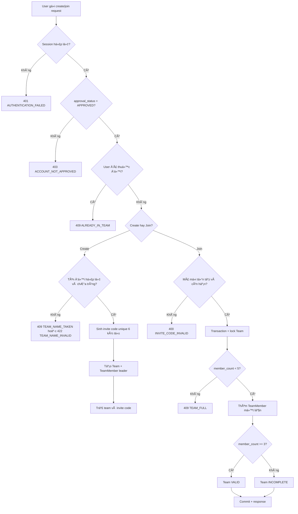
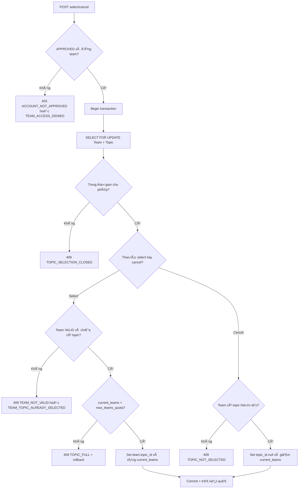
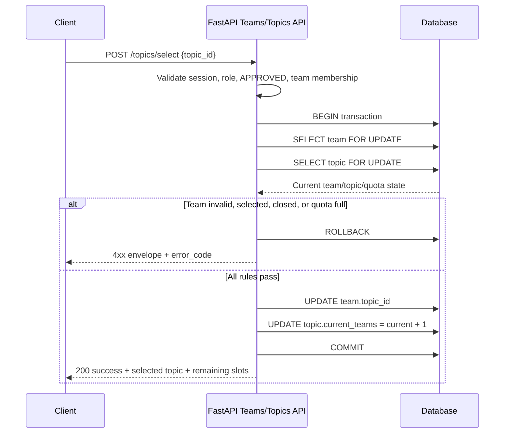

---
id: "HF-04"
title: "Viết đặc tả SRS luồng Tạo đội & Chọn đề tài"
status: "In Review"
assignee: "Phuong ly Dinh"
priority: "P0"
deadline: "2026-10-05"
notion_url: "https://app.notion.com/p/HF-04-Vi-t-c-t-SRS-lu-ng-T-o-i-Ch-n-t-i-6b6ae9627fac485db5ca4ade280f69a1"
last_edited: "00:00:00 5/10/2026"
pulled_at: "00:05:54 5/10/2026"
---

# HF-04 — Viết đặc tả SRS luồng Tạo đội & Chọn đề tài

| | |
|---|---|
| **Status** | In Review |
| **Assignee** | Phuong ly Dinh |
| **Sprint** | — |
| **Ưu tiên** | P0 |
| **Hạn hoàn thành** | 2026-10-05 |
| **Cập nhật** | 00:00:00 5/10/2026 |
| **Notion** | [Mở trang](https://app.notion.com/p/HF-04-Vi-t-c-t-SRS-lu-ng-T-o-i-Ch-n-t-i-6b6ae9627fac485db5ca4ade280f69a1) |

---

@Phuong ly Dinh

# Mục tiêu
Viết đặc tả chức năng cho tạo/join đội và chọn đề tài có quota, khóa sau khi chọn.

## Checklist thực hiện
- Trong SRS — Sprint 1 & 2, mô tả điều kiện chỉ tài khoản APPROVED mới được tạo hoặc tham gia đội.
- Đặc tả tạo đội, sinh mã mời duy nhất, kiểm tra tên đội và giới hạn 3–5 người.
- Đặc tả join bằng invite code: mã sai/hết hạn, đội đầy, người dùng đã thuộc đội khác và dữ liệu không đổi khi lỗi.
- Đặc tả danh sách đề tài, quota, current_teams, chọn một đề tài và cơ chế khóa/hủy chọn khi còn hạn.
- Mô tả tranh chấp đồng thời bằng transaction + SELECT FOR UPDATE, lỗi TOPIC_FULL và các quyền bị chặn.
- Vẽ flowchart hoặc sequence diagram cho happy path và exception/error path.

## Definition of Done
SRS có đầy đủ rule 3–5 thành viên, invite code, quota, khóa đề tài, kiểm tra phân quyền, transaction và mã lỗi; đủ chi tiết để chuyển thành API/UI/test case.

## Quy ước bàn giao
- Cập nhật trạng thái In Review khi đã có sản phẩm và link bàn giao.
- Chỉ chuyển Done sau khi PM kiểm tra DoD và nghiệm thu.

## Sản phẩm bàn giao
Đã hoàn thiện đặc tả trong SRS — Sprint 1 & 2: Auth & Onboarding, mục 9. SRS — Teams & Topics (HF-04).
Nội dung đã bao phủ đúng Definition of Done của HF-04:
- Điều kiện quyền: chỉ role CANDIDATE có approval_status = APPROVED được tạo/join đội và chọn/hủy chọn đề tài; PENDING/REJECTED bị chặn.
- Luồng tạo đội: validate tên đội, giới hạn 3–5 thành viên, sinh invite code unique 6 ký tự, gán đội trưởng và trạng thái INCOMPLETE/VALID.
- Luồng join: mã sai/hết hạn/khác cuộc thi, đội đầy, user đã thuộc đội khác, request trùng/đồng thời; lỗi không làm thay đổi dữ liệu.
- Luồng Topics: danh sách đề tài, max_teams_quota, current_teams, chọn một đề tài, khóa sau thời gian cho phép và hủy chọn khi còn hạn.
- Concurrency: transaction + SELECT FOR UPDATE trên Team/Topic; cập nhật team.topic_id và current_teams nguyên tử; quota đầy trả TOPIC_FULL và rollback.
- API contract, API envelope, mã lỗi, flowchart happy/exception path, sequence diagram và ma trận bàn giao UI/Backend/UAT.

### Liên kết triển khai theo luồng dự án
- Backend triển khai Teams API theo POST /api/v1/teams và POST /api/v1/teams/join tại HF-20.
- Backend triển khai Topics API theo POST /api/v1/topics/select, transaction và SELECT FOR UPDATE tại HF-21.
- UI/UX sử dụng các trạng thái Teams/Topics, quota, HẾT SLOT, ĐÃ CHỌN và Hủy chọn tại HF-09.
- BA/UAT chuyển các nhánh happy path, exception path và concurrency trong SRS thành test case tại HF-05.
Trạng thái bàn giao: In Review — chờ Minh kiểm tra Definition of Done và nghiệm thu; không tự chuyển sang Done trước khi PM xác nhận.

---
*Kéo từ Notion lúc 00:05:54 5/10/2026 bởi notion-module*


---

## Nội dung chi tiết Mục 9 (Từ SRS Master Page)


## 9. SRS — Teams & Topics (HF-04)

Phiên bản: v1.0 — 04/10/2026
Phạm vi: Sprint 1 — Core MVP; chuẩn bị nền tảng cho Sprint 2.
Phụ thuộc: Auth & Onboarding; tài khoản phải có approval_status = APPROVED.


### 9.1. Mục tiêu và phạm vi

Đặc tả hai luồng nghiệp vụ của thí sinh:

1. Teams: tạo đội hoặc tham gia đội bằng invite code.
1. Topics: xem danh sách đề tài có quota, chọn một đề tài và hủy lựa chọn khi còn trong thời gian cho phép.
Không cho phép tài khoản PENDING hoặc REJECTED tạo/tham gia đội, chọn/hủy chọn đề tài. Backend/API là lớp quyết định cuối cùng; việc ẩn hoặc disable nút trên UI không thay thế kiểm tra quyền ở Backend.


### 9.2. Tác nhân và quyền


| Tác nhân | Quyền trong phạm vi HF-04 |
| Thí sinh CANDIDATE  • APPROVED | Tạo đội nếu chưa thuộc đội; tham gia đội bằng mã mời nếu chưa thuộc đội; xem đội của mình; xem danh sách đề tài; chọn/hủy chọn đề tài theo rule. |
| Thí sinh PENDING | Chỉ xem/cập nhật onboarding và trạng thái duyệt; bị chặn toàn bộ API Teams/Topics. |
| Thí sinh REJECTED | Bị chặn Teams/Topics; UI hiển thị lý do từ chối và hướng dẫn liên hệ hỗ trợ. |
| Ban tổ chức | Cấu hình danh sách đề tài, quota, thời gian; xem và quản lý dữ liệu đội/đề tài theo quyền quản trị. Không dùng quyền quản trị để bỏ qua transaction hoặc làm sai lịch sử lựa chọn. |
| Backend/API | Xác thực phiên, RBAC, approval_status, constraint dữ liệu, transaction, lock và API envelope. |


### 9.3. Quy tắc nghiệp vụ Teams


#### 9.3.1. Điều kiện chung

- Chỉ user đăng nhập hợp lệ, role CANDIDATE và approval_status = APPROVED mới được gọi API Teams.
- Một user chỉ thuộc tối đa một đội trong một cuộc thi.
- Một đội hợp lệ có tối thiểu 3 và tối đa 5 thành viên. Khi mới tạo, đội trưởng là thành viên đầu tiên; đội có thể ở trạng thái INCOMPLETE cho tới khi đủ 3 người.
- Tên đội là bắt buộc, được trim khoảng trắng, dài 3–50 ký tự, không chỉ gồm khoảng trắng và không được trùng trong cùng cuộc thi sau khi chuẩn hóa không phân biệt hoa thường.
- Invite code do Backend sinh ngẫu nhiên, duy nhất trong phạm vi cuộc thi, dài 6 ký tự, dễ đọc và không chứa khoảng trắng. Client không tự sinh hoặc tự sửa mã.
- Invite code có trạng thái ACTIVE/EXPIRED/REVOKED; chỉ mã ACTIVE mới được dùng để join.
- Nếu một bước kiểm tra thất bại, transaction rollback; không tạo đội, không thêm thành viên và không thay đổi dữ liệu đã có.

#### 9.3.2. Tạo đội — happy path

Input: competition_id, name. User lấy từ session hiện tại; client không được tự truyền owner_id hoặc approval_status để quyết định quyền.

1. Backend xác thực session, role và approval_status.
1. Kiểm tra user chưa thuộc đội trong competition_id.
1. Chuẩn hóa và kiểm tra tên đội chưa tồn tại.
1. Sinh invite code 6 ký tự và kiểm tra uniqueness; nếu có xung đột hiếm gặp, sinh lại trong transaction.
1. Tạo Team ở trạng thái INCOMPLETE, gán user hiện tại là LEADER, tạo TeamMember đầu tiên và trả thông tin đội.
Output thành công: HTTP 201, API envelope success = true, gồm team_id, name, status, invite_code, member_count = 1, min_members = 3, max_members = 5, topic_id = null.


#### 9.3.3. Tham gia đội bằng invite code — happy path

Input: competition_id, invite_code.

1. Backend xác thực user là APPROVED và chưa thuộc đội trong cuộc thi.
1. Tìm invite code đúng cuộc thi, kiểm tra mã tồn tại và còn hiệu lực.
1. Khóa/kiểm tra dữ liệu đội trong transaction để không vượt giới hạn 5 người khi có nhiều request đồng thời.
1. Nếu đội còn chỗ, thêm user đúng một lần vào TeamMember.
1. Cập nhật trạng thái đội thành VALID khi member count đạt 3–5; nếu chưa đủ, giữ INCOMPLETE.
Output thành công: HTTP 200, trả team_id, name, status, member_count, danh sách thành viên trong phạm vi được phép và topic_id hiện tại.


#### 9.3.4. Các trường hợp bị chặn và không đổi dữ liệu

- PENDING/REJECTED: HTTP 403, ACCOUNT_NOT_APPROVED; không tạo/join đội.
- User đã thuộc đội: HTTP 409, ALREADY_IN_TEAM; không thêm thành viên.
- Invite code sai, khác cuộc thi, hết hạn hoặc bị thu hồi: HTTP 404 hoặc 400 theo quy ước API, INVITE_CODE_INVALID; không đổi dữ liệu.
- Đội đã đủ 5 người: HTTP 409, TEAM_FULL; không thêm thành viên.
- Tên đội trống, quá dài hoặc trùng: HTTP 422 với TEAM_NAME_INVALID hoặc HTTP 409 với TEAM_NAME_TAKEN.
- Request trùng/đồng thời: hệ thống chỉ ghi nhận một thành viên; request còn lại trả lỗi nghiệp vụ phù hợp hoặc kết quả idempotent theo Idempotency-Key, không tạo duplicate.

### 9.4. Quy tắc nghiệp vụ Topics


#### 9.4.1. Dữ liệu đề tài

Mỗi Topic tối thiểu có:

- topic_id, title, description, domain.
- max_teams_quota: quota tối đa, số nguyên dương.
- current_teams: số đội hiện đang giữ đề tài, không âm và không vượt max_teams_quota.
- selection_start_at, selection_end_at, status (OPEN, CLOSED, ARCHIVED).
- mentor_id hoặc thông tin mentor phụ trách nếu đã được phân công.
Danh sách Topics trả về current_teams, max_teams_quota, số slot còn lại và trạng thái hiển thị AVAILABLE, FULL, NOT_STARTED hoặc CLOSED. Client không được tự suy ra quota cuối cùng để quyết định; Backend kiểm tra lại tại thời điểm ghi dữ liệu.


#### 9.4.2. Điều kiện chọn đề tài

- User phải là APPROVED.
- Team phải tồn tại trong cuộc thi, user phải là thành viên của team và team phải ở trạng thái VALID (đủ 3–5 người).
- Team chưa có topic_id; không được chọn đề tài thứ hai hoặc ghi đè đề tài hiện tại.
- Topic phải tồn tại, ở trạng thái OPEN và thời điểm server nằm trong khoảng cho phép.
- Chỉ chấp nhận khi current_teams < max_teams_quota.

#### 9.4.3. Chọn đề tài — transaction và tranh chấp đồng thời

Endpoint POST /api/v1/topics/select nhận { "topic_id": "uuid" }. Backend thực hiện trong một transaction:

1. Xác thực user/session, APPROVED, role và membership của team.
1. Khóa bản ghi Team và Topic liên quan bằng SELECT FOR UPDATE.
1. Đọc lại trạng thái thời gian, team.topic_id, current_teams và max_teams_quota sau khi đã có lock.
1. Nếu mọi điều kiện hợp lệ, cập nhật team.topic_id = topic_id và tăng current_teams đúng một lần.
1. Commit; trả về đề tài đã chọn và số slot còn lại.
1. Nếu bất kỳ bước nào lỗi, rollback toàn bộ; không cập nhật một phần Team hoặc Topic.
Khi nhiều đội cùng chọn slot cuối, chỉ transaction giành được lock trước và còn quota mới thành công. Các transaction sau khi đọc lại dữ liệu phải trả 409 TOPIC_FULL, không được làm current_teams vượt quota.


#### 9.4.4. Hủy chọn đề tài khi còn hạn

Endpoint POST /api/v1/topics/cancel nhận { "team_id": "uuid" }.

- Chỉ đội trưởng hoặc thành viên APPROVED thuộc đúng team mới được yêu cầu hủy; triển khai cần chốt một quyền chính thức ở API, mặc định ưu tiên đội trưởng để tránh hủy ngoài ý muốn.
- Team phải đang có topic_id và thời điểm server vẫn nằm trong selection_end_at.
- Backend khóa Team và Topic bằng transaction + SELECT FOR UPDATE, kiểm tra quan hệ hiện tại, sau đó đặt team.topic_id = null và giảm topic.current_teams đúng một lần.
- Sau khi hủy, team được phép chọn lại một đề tài khác nếu còn hạn; không được chuyển thẳng từ Topic A sang Topic B trong cùng request.
- Sau selection_end_at, trả 409 TOPIC_SELECTION_LOCKED; không thay đổi team.topic_id hoặc current_teams.
- Nếu Topic đã bị xóa/không còn nhất quán, rollback và tạo cảnh báo để BTC xử lý; tuyệt đối không giảm quota âm.

#### 9.4.5. Các trường hợp chọn đề tài bị chặn

- PENDING/REJECTED: 403 ACCOUNT_NOT_APPROVED.
- Team không tồn tại hoặc user không thuộc team: 403 TEAM_ACCESS_DENIED.
- Team chưa đủ 3 thành viên: 409 TEAM_NOT_VALID.
- Team đã có đề tài: 409 TEAM_TOPIC_ALREADY_SELECTED.
- Topic không tồn tại: 404 TOPIC_NOT_FOUND.
- Ngoài thời gian hoặc Topic đã đóng: 409 TOPIC_SELECTION_CLOSED.
- Quota đã đầy tại thời điểm transaction: 409 TOPIC_FULL.
- Dữ liệu cập nhật không còn đúng trong lúc transaction: rollback, trả mã lỗi phù hợp và không đổi dữ liệu.

### 9.5. API contract đề xuất


| Method | Endpoint | Mục đích | Quyền |
| GET | /api/v1/teams/me | Xem đội hiện tại của user trong cuộc thi | APPROVED |
| POST | /api/v1/teams | Tạo đội, sinh invite code và gán leader | APPROVED, chưa thuộc đội |
| POST | /api/v1/teams/join | Tham gia bằng invite_code | APPROVED, chưa thuộc đội |
| GET | /api/v1/topics | Xem danh sách đề tài, quota và trạng thái | User đã đăng nhập |
| POST | /api/v1/topics/select | Chọn một đề tài bằng transaction + lock | APPROVED, team VALID |
| POST | /api/v1/topics/cancel | Hủy lựa chọn khi còn hạn | APPROVED, thành viên đúng team; mặc định leader |


Envelope thành công:

```json
{
  "success": true,
  "data": {},
  "message": "Operation completed",
  "error_code": null
}
```

Envelope lá»—i:

```json
{
  "success": false,
  "data": null,
  "message": "Readable business error",
  "error_code": "TOPIC_FULL"
}
```


### 9.6. Flowchart nghiệp vụ


#### 9.6.1. Tạo/join đội — happy path và exception path




#### 9.6.2. Chọn/hủy đề tài — quota và concurrency




### 9.7. Sequence diagram chọn đề tài




### 9.8. Mapping sang UI, Backend và UAT


| Hạng mục | UI/UX cần thể hiện | Backend cần bảo đảm | UAT tối thiểu |
| Teams chưa có đội | Hai lựa chọn Tạo đội mới và Nhập mã mời | Quyền APPROVED, tên đội, code unique, membership | Tạo thành công; tên trùng; PENDING/REJECTED; mã sai; đội đầy; đã thuộc đội |
| Teams đã có đội | Tên đội, code + Copy, leader/member badge, 3–5 thành viên | Không join/create đội thứ hai; member count không vượt 5 | Join đồng thời; duplicate request; đội chuyển VALID ở thành viên thứ 3 |
| Topics | Card tên/lĩnh vực, current_teams/max_teams_quota, mentor, Chọn, ĐÃ CHỌN, HẾT SLOT | Quota kiểm tra lại trong transaction; SELECT FOR UPDATE; TOPIC_FULL | Chọn thành công; team chưa đủ người; đã chọn; ngoài hạn; quota đầy; race condition |
| Hủy chọn | Nút Hủy chọn chỉ hiện khi còn hạn; modal xác nhận; card khác mở lại sau khi hủy | Lock Team + Topic; giảm quota đúng một lần; khóa sau deadline | Hủy thành công; hủy sau hạn; hủy khi không có topic; chọn lại sau khi hủy |
| Trạng thái lỗi | Loading, empty, error; message dễ hiểu; không giữ trạng thái thành công giả | API envelope thống nhất, rollback khi lỗi | Refresh sau lỗi; retry; không có dữ liệu một phần |


### 9.9. Mã lỗi chuẩn của Teams & Topics


| HTTP | error_code | Ý nghĩa |
| 401 | AUTHENTICATION_FAILED / SESSION_EXPIRED | Chưa đăng nhập hoặc phiên hết hạn |
| 403 | ACCOUNT_NOT_APPROVED | PENDING hoặc REJECTED gọi chức năng bị khóa |
| 403 | TEAM_ACCESS_DENIED | User không thuộc team hoặc không có quyền thao tác |
| 409 | ALREADY_IN_TEAM | User đã thuộc đội trong cuộc thi |
| 409 | TEAM_NAME_TAKEN | Tên đội đã tồn tại trong cuộc thi |
| 409 | TEAM_FULL | Đội đã đủ 5 người |
| 409 | TEAM_NOT_VALID | Đội chưa đủ 3 người hoặc không đạt điều kiện |
| 409 | TEAM_TOPIC_ALREADY_SELECTED | Đội đã có đề tài, không được ghi đè |
| 409 | TOPIC_FULL | Quota đã đầy sau khi lock và kiểm tra lại |
| 409 | TOPIC_SELECTION_CLOSED | Ngoài thời gian chọn/hủy hoặc Topic đã đóng |
| 409 | TOPIC_NOT_SELECTED | Team chưa có đề tài để hủy |
| 400 | INVITE_CODE_INVALID | Mã mời sai, hết hạn, bị thu hồi hoặc khác cuộc thi |
| 404 | TOPIC_NOT_FOUND | Không tìm thấy đề tài |
| 422 | TEAM_NAME_INVALID / VALIDATION_ERROR | Input thiếu hoặc sai định dạng |
| 500 | TRANSACTION_FAILED | Lỗi hệ thống; phải rollback toàn bộ |


### 9.10. Traceability và Definition of Done

- US-03: được bao phủ bởi mục 9.3, API Teams, flowchart Teams và các case create/join/error.
- US-04: được bao phủ bởi mục 9.4, API Topics, transaction/SELECT FOR UPDATE, flowchart Topics và concurrency test.
- SRS mô tả đủ actor, precondition, input/output, happy path, exception path, trạng thái, quyền và mã lỗi.
- Rule đội 3–5 người, invite code unique 6 ký tự, quota/current_teams, khóa đề tài sau thời gian và hủy chọn khi còn hạn đã được chốt trong tài liệu.
- TOPIC_FULL chỉ trả sau khi transaction đã lock và đọc lại quota; lỗi phải rollback, không làm thay đổi dữ liệu một phần.
- SRS đủ chi tiết để Backend triển khai HF-20/HF-21, UI/UX triển khai HF-09, Frontend tích hợp Teams/Topics và BA tạo test case HF-05.

