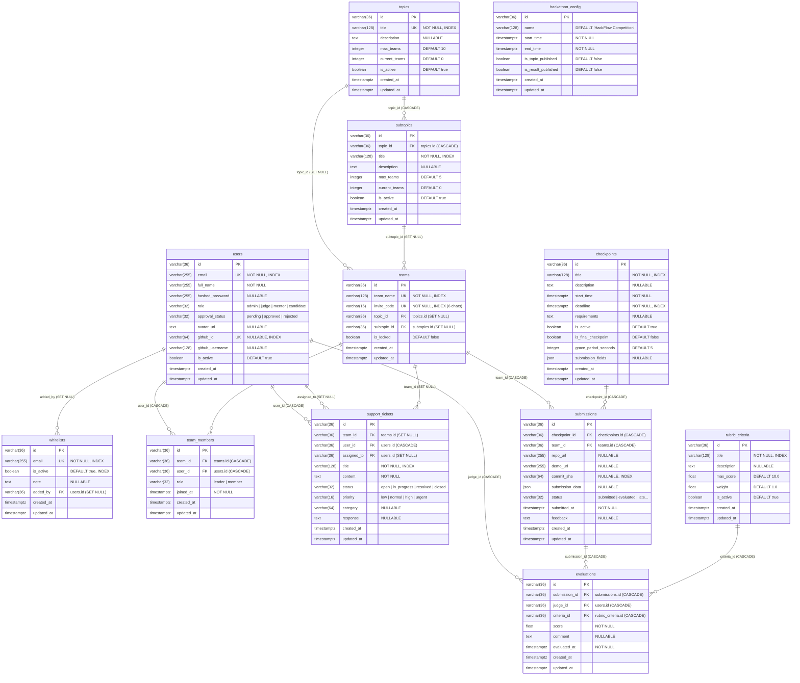

# 🗄️ Tài liệu Thiết kế Cơ sở Dữ liệu Chi tiết (Database Schema Specification)

> **Dự án:** HackFlow9 — Nền tảng Quản lý & Chấm thi Hackathon Khép kín  
> **Hệ quản trị CSDL:** PostgreSQL 15+ (Supabase) / SQLite 3 (`aiosqlite`)  
> **ORM & Migration:** SQLAlchemy 2.0 (Async Declarative) + Alembic  
> **Mã nguồn Models:** [`backend/app/models/`](../../backend/app/models/)

---

## 1. Quy ước Thiết kế Chung (Database Conventions)

Toàn bộ **12 bảng vật lý** trong hệ thống đều kế thừa từ lớp cơ sở trừu tượng [`BaseModel`](../../backend/app/models/base.py) (kết hợp `UUIDMixin` và `TimestampMixin`), tuân thủ các chuẩn mực thống nhất:
1. **Khóa chính (Primary Key)**: Mọi bảng đều sử dụng cột `id` kiểu `VARCHAR(36)` lưu trữ chuỗi **UUID v4** (`uuid.uuid4()`), được đánh chỉ mục (`INDEX`) mặc định. Việc dùng UUIDv4 giúp chống lộ số lượng bản ghi tuần tự (ID Enumeration Attack) và thuận tiện khi đồng bộ dữ liệu phân tán.
2. **Dấu thời gian kiểm toán (Audit Timestamps)**: Mọi bảng đều có 2 cột bắt buộc chuẩn múi giờ UTC (`DateTime(timezone=True)`):
   - `created_at`: Thời điểm bản ghi được khởi tạo.
   - `updated_at`: Thời điểm bản ghi được cập nhật lần cuối (tự động cập nhật qua `onupdate`).
3. **Đặt tên bảng & cột**: Sử dụng `snake_case`, tên bảng ở dạng số nhiều (`users`, `teams`, `team_members`, `topics`, `subtopics`, `checkpoints`, `submissions`, `rubric_criteria`, `evaluations`, `support_tickets`, `whitelists`, và `hackathon_config`).
4. **Cơ chế Toàn vẹn Tham chiếu (Referential Integrity)**: Tất cả khóa ngoại (`ForeignKey`) đều định nghĩa rõ hành vi `ON DELETE CASCADE` (xóa dây chuyền các bản ghi phụ thuộc chặt) hoặc `ON DELETE SET NULL` (giữ lại lịch sử khi đối tượng liên kết bị xóa).

---

## 2. Sơ đồ Thực thể Liên kết Toàn hệ thống (Entity-Relationship Diagram)

---

## 3. Đặc tả Chi tiết Từng Bảng (Table-by-Table Specification)

### 3.1. Bảng `users` — Quản lý Tài khoản Người dùng
- **File định nghĩa:** [`backend/app/models/user.py`](../../backend/app/models/user.py)
- **Mục đích:** Lưu trữ toàn bộ tài khoản của 4 vai trò (`admin`, `judge`, `mentor`, `candidate`), hỗ trợ cả xác thực mật khẩu nội bộ lẫn GitHub OAuth 2.0.

| Tên cột | Kiểu dữ liệu | Ràng buộc (Constraints) | Mặc định | Mô tả chi tiết |
|---|---|---|---|---|
| `id` | `VARCHAR(36)` | `PRIMARY KEY`, `INDEX` | `uuid4()` | Định danh duy nhất của người dùng |
| `email` | `VARCHAR(255)` | `NOT NULL`, `UNIQUE`, `INDEX` | — | Địa chỉ email đăng nhập (chuẩn hóa chữ thường) |
| `full_name` | `VARCHAR(255)` | `NOT NULL` | — | Họ và tên hiển thị |
| `hashed_password` | `VARCHAR(255)` | `NULLABLE` | `NULL` | Chuỗi băm SHA-256 salted password (`NULL` nếu chỉ đăng nhập qua GitHub OAuth) |
| `role` | `VARCHAR(32)` | `NOT NULL`, `INDEX` | `'candidate'` | Vai trò hệ thống (`UserRole`: `'admin'`, `'judge'`, `'mentor'`, `'candidate'`) |
| `approval_status` | `VARCHAR(32)` | `NOT NULL`, `INDEX` | `'pending'` | Trạng thái xét duyệt (`ApprovalStatus`: `'pending'`, `'approved'`, `'rejected'`) |
| `avatar_url` | `TEXT` | `NULLABLE` | `NULL` | Đường dẫn ảnh đại diện (đồng bộ từ GitHub hoặc tự cấu hình) |
| `github_id` | `VARCHAR(64)` | `NULLABLE`, `UNIQUE`, `INDEX` | `NULL` | ID tài khoản GitHub duy nhất dùng cho OAuth 2.0 |
| `github_username` | `VARCHAR(128)` | `NULLABLE` | `NULL` | Username GitHub (ví dụ: `minhlt6`) |
| `is_active` | `BOOLEAN` | `NOT NULL` | `true` | Cờ kích hoạt tài khoản (`false` = khóa đăng nhập) |
| `created_at` | `TIMESTAMPTZ` | `NOT NULL` | `now(utc)` | Thời điểm tạo tài khoản |
| `updated_at` | `TIMESTAMPTZ` | `NOT NULL` | `now(utc)` | Thời điểm cập nhật gần nhất |

> **Lưu trữ mở rộng Hồ sơ Thí sinh (`backend/user_profiles.json`)**:
> Để lưu trữ linh hoạt các trường thông tin đăng ký/Onboarding của thí sinh mà không làm phình bảng `users` cho các vai trò quản trị, endpoint `POST /api/v1/users/profile` tại [`auth.py`](../../backend/app/api/v1/endpoints/auth.py) kết hợp cập nhật `full_name` trong bảng `users` và lưu các thuộc tính mở rộng vào `user_profiles.json` theo khóa `user.id` và `user.email`:
> - `student_id` (`string`): Mã số sinh viên (MSSV)
> - `school` (`string`): Trường Đại học / Đơn vị đào tạo
> - `phone` (`string`): Số điện thoại liên hệ (10–11 chữ số)
> - `skills` (`List[str]`): Danh sách kỹ năng chuyên môn (ví dụ: `["Frontend (React/Vue)", "Backend (Node/Python/Go)", "AI / Machine Learning"]`)

---

### 3.2. Bảng `whitelists` — Danh sách Email Phê duyệt Trước (BTC Whitelist)
- **File định nghĩa:** [`backend/app/models/whitelist.py`](../../backend/app/models/whitelist.py)
- **Mục đích:** Lưu danh sách email được Ban Tổ Chức import sẵn hoặc tự động ghi nhận khi BTC duyệt một ứng viên. Khi thí sinh đăng nhập qua GitHub OAuth có email nằm trong bảng này với `is_active = true`, tài khoản được cấp thẳng trạng thái `'approved'`.

| Tên cột | Kiểu dữ liệu | Ràng buộc (Constraints) | Mặc định | Mô tả chi tiết |
|---|---|---|---|---|
| `id` | `VARCHAR(36)` | `PRIMARY KEY`, `INDEX` | `uuid4()` | Mã định danh bản ghi whitelist |
| `email` | `VARCHAR(255)` | `NOT NULL`, `UNIQUE`, `INDEX` | — | Email được phép vào thẳng hệ thống |
| `is_active` | `BOOLEAN` | `NOT NULL`, `INDEX` | `true` | Hiệu lực của email trong whitelist |
| `note` | `TEXT` | `NULLABLE` | `NULL` | Ghi chú của BTC (VD: `"SV CNTT K21 - ĐH Bách Khoa"`) |
| `added_by` | `VARCHAR(36)` | `FK -> users.id (ON DELETE SET NULL)`, `INDEX` | `NULL` | ID của Admin đã thêm/duyệt email này |
| `created_at` | `TIMESTAMPTZ` | `NOT NULL` | `now(utc)` | Thời điểm thêm vào whitelist |
| `updated_at` | `TIMESTAMPTZ` | `NOT NULL` | `now(utc)` | Thời điểm cập nhật |

---

### 3.3. Bảng `teams` — Đội thi Hackathon
- **File định nghĩa:** [`backend/app/models/team.py`](../../backend/app/models/team.py)
- **Mục đích:** Quản lý thông tin đội thi, mã mời 6 ký tự và đề tài mà đội đã đăng ký.

| Tên cột | Kiểu dữ liệu | Ràng buộc (Constraints) | Mặc định | Mô tả chi tiết |
|---|---|---|---|---|
| `id` | `VARCHAR(36)` | `PRIMARY KEY`, `INDEX` | `uuid4()` | Mã định danh đội thi |
| `team_name` | `VARCHAR(128)` | `NOT NULL`, `UNIQUE`, `INDEX` | — | Tên đội thi duy nhất trên toàn cuộc thi |
| `invite_code` | `VARCHAR(16)` | `NOT NULL`, `UNIQUE`, `INDEX` | — | Mã mời 6 ký tự chữ-số in hoa ngẫu nhiên (VD: `CYB9X2`) |
| `topic_id` | `VARCHAR(36)` | `FK -> topics.id (ON DELETE SET NULL)`, `INDEX` | `NULL` | Chủ đề / Đề tài chính mà đội đã chọn |
| `subtopic_id` | `VARCHAR(36)` | `FK -> subtopics.id (ON DELETE SET NULL)`, `INDEX` | `NULL` | Đề tài con chi tiết (nếu có) |
| `is_locked` | `BOOLEAN` | `NOT NULL` | `false` | Trạng thái chốt đội (`true` = khóa tuyển thêm/rời đội) |
| `created_at` | `TIMESTAMPTZ` | `NOT NULL` | `now(utc)` | Thời điểm thành lập đội |
| `updated_at` | `TIMESTAMPTZ` | `NOT NULL` | `now(utc)` | Thời điểm cập nhật gần nhất |

---

### 3.4. Bảng `team_members` — Thành viên Đội thi & Vai trò Nội bộ
- **File định nghĩa:** [`backend/app/models/team.py`](../../backend/app/models/team.py)
- **Mục đích:** Bảng trung gian liên kết `users` và `teams`, định nghĩa ai là Đội trưởng (`leader`) và ai là Thành viên (`member`).
- **Quy tắc nghiệp vụ:** Mỗi đội tối đa **5 thành viên**, tối thiểu **3 thành viên** để đủ điều kiện (`QUALIFIED`) đăng ký đề tài; mỗi thời điểm có duy nhất **1 `leader`**.

| Tên cột | Kiểu dữ liệu | Ràng buộc (Constraints) | Mặc định | Mô tả chi tiết |
|---|---|---|---|---|
| `id` | `VARCHAR(36)` | `PRIMARY KEY`, `INDEX` | `uuid4()` | Mã định danh bản ghi thành viên |
| `team_id` | `VARCHAR(36)` | `NOT NULL`, `FK -> teams.id (ON DELETE CASCADE)`, `INDEX` | — | Đội thi mà thành viên trực thuộc |
| `user_id` | `VARCHAR(36)` | `NOT NULL`, `FK -> users.id (ON DELETE CASCADE)`, `INDEX` | — | Tài khoản thí sinh |
| `role` | `VARCHAR(32)` | `NOT NULL` | `'member'` | Vai trò trong đội (`TeamMemberRole`: `'leader'` hoặc `'member'`) |
| `joined_at` | `TIMESTAMPTZ` | `NOT NULL` | `now(utc)` | Thời điểm gia nhập đội |
| `created_at` | `TIMESTAMPTZ` | `NOT NULL` | `now(utc)` | Thời điểm tạo bản ghi |
| `updated_at` | `TIMESTAMPTZ` | `NOT NULL` | `now(utc)` | Thời điểm cập nhật vai trò (ví dụ khi chuyển quyền Đội trưởng) |

---

### 3.5. Bảng `topics` & `subtopics` — Danh mục Đề tài và Hạn ngạch (Quota)
- **File định nghĩa:** [`backend/app/models/topic.py`](../../backend/app/models/topic.py)
- **Mục đích:** Quản lý danh mục đề tài thi đấu và giới hạn số lượng đội tối đa được phép chọn mỗi đề tài.

#### Bảng `topics` (Chủ đề / Đề tài chính):
| Tên cột | Kiểu dữ liệu | Ràng buộc (Constraints) | Mặc định | Mô tả chi tiết |
|---|---|---|---|---|
| `id` | `VARCHAR(36)` | `PRIMARY KEY`, `INDEX` | `uuid4()` | Mã đề tài chính |
| `title` | `VARCHAR(128)` | `NOT NULL`, `UNIQUE`, `INDEX` | — | Tên đề tài / Track thi đấu |
| `description` | `TEXT` | `NULLABLE` | `NULL` | Mô tả chi tiết bài toán và yêu cầu |
| `max_teams` | `INTEGER` | `NOT NULL` | `10` | Hạn ngạch (Quota) số đội tối đa được chọn |
| `current_teams` | `INTEGER` | `NOT NULL` | `0` | Số đội hiện tại đã đăng ký (được bảo vệ bởi `SELECT FOR UPDATE`) |
| `is_active` | `BOOLEAN` | `NOT NULL` | `true` | Trạng thái mở đăng ký cho đề tài |
| `created_at` | `TIMESTAMPTZ` | `NOT NULL` | `now(utc)` | Thời điểm tạo |
| `updated_at` | `TIMESTAMPTZ` | `NOT NULL` | `now(utc)` | Thời điểm cập nhật |

#### Bảng `subtopics` (Đề tài nhánh):
| Tên cột | Kiểu dữ liệu | Ràng buộc (Constraints) | Mặc định | Mô tả chi tiết |
|---|---|---|---|---|
| `id` | `VARCHAR(36)` | `PRIMARY KEY`, `INDEX` | `uuid4()` | Mã đề tài nhánh |
| `topic_id` | `VARCHAR(36)` | `NOT NULL`, `FK -> topics.id (ON DELETE CASCADE)`, `INDEX` | — | Liên kết tới chủ đề cha |
| `title` | `VARCHAR(128)` | `NOT NULL`, `INDEX` | — | Tên đề tài nhánh |
| `description` | `TEXT` | `NULLABLE` | `NULL` | Nội dung yêu cầu chi tiết |
| `max_teams` | `INTEGER` | `NOT NULL` | `5` | Số đội tối đa được chọn đề tài nhánh này |
| `current_teams` | `INTEGER` | `NOT NULL` | `0` | Số đội hiện tại đã đăng ký |
| `is_active` | `BOOLEAN` | `NOT NULL` | `true` | Cờ kích hoạt |
| `created_at` / `updated_at` | `TIMESTAMPTZ` | `NOT NULL` | `now(utc)` | Dấu thời gian kiểm toán |

---

### 3.6. Bảng `checkpoints` — Mốc Kiểm tra Tiến độ Time-Gated
- **File định nghĩa:** [`backend/app/models/checkpoint.py`](../../backend/app/models/checkpoint.py)
- **Mục đích:** Cấu hình các chặng báo cáo tiến độ mở/đóng tự động theo giờ Server.

| Tên cột | Kiểu dữ liệu | Ràng buộc (Constraints) | Mặc định | Mô tả chi tiết |
|---|---|---|---|---|
| `id` | `VARCHAR(36)` | `PRIMARY KEY`, `INDEX` | `uuid4()` | Mã định danh Checkpoint |
| `title` | `VARCHAR(128)` | `NOT NULL`, `INDEX` | — | Tên chặng (VD: `"Checkpoint 1: Đặc tả & Kiến trúc"`) |
| `description` | `TEXT` | `NULLABLE` | `NULL` | Mô tả mục tiêu của chặng |
| `start_time` | `TIMESTAMPTZ` | `NOT NULL` | — | Thời điểm bắt đầu mở cổng nộp bài (UTC) |
| `deadline` | `TIMESTAMPTZ` | `NOT NULL`, `INDEX` | — | Hạn chót đóng cổng nộp bài (UTC) |
| `requirements` | `TEXT` | `NULLABLE` | `NULL` | Danh sách tài liệu/sản phẩm yêu cầu nộp |
| `is_active` | `BOOLEAN` | `NOT NULL` | `true` | Cho phép BTC bật/tắt khẩn cấp cổng nộp bài |
| `is_final_checkpoint` | `BOOLEAN` | `NOT NULL` | `false` | Đánh dấu mốc nộp bài Chung kết (Final Submission) |
| `grace_period_seconds` | `INTEGER` | `NOT NULL` | `5` | Thời gian ân hạn bù độ trễ mạng (giây) sau `deadline` |
| `submission_fields` | `JSON` | `NULLABLE` | `NULL` | Cấu hình động các trường form nộp bài (Repo URL, Slide, Video...) |
| `created_at` / `updated_at` | `TIMESTAMPTZ` | `NOT NULL` | `now(utc)` | Dấu thời gian kiểm toán |

---

### 3.7. Bảng `submissions` — Bài nộp của Đội thi & Đóng băng Commit SHA
- **File định nghĩa:** [`backend/app/models/checkpoint.py`](../../backend/app/models/checkpoint.py)
- **Mục đích:** Lưu trữ bài nộp của từng đội tại mỗi mốc Checkpoint kèm mã băm GitHub Commit SHA tại thời điểm nộp.
- **Ràng buộc Duy nhất (Unique Constraint):** `uq_submission_team_checkpoint (team_id, checkpoint_id)` đảm bảo mỗi đội chỉ có một bản ghi chính thức cho mỗi Checkpoint (khi nộp lại trong thời hạn sẽ ghi đè/cập nhật bản ghi đó).

| Tên cột | Kiểu dữ liệu | Ràng buộc (Constraints) | Mặc định | Mô tả chi tiết |
|---|---|---|---|---|
| `id` | `VARCHAR(36)` | `PRIMARY KEY`, `INDEX` | `uuid4()` | Mã bài nộp |
| `checkpoint_id` | `VARCHAR(36)` | `NOT NULL`, `FK -> checkpoints.id (ON DELETE CASCADE)`, `INDEX` | — | Thuộc mốc Checkpoint nào |
| `team_id` | `VARCHAR(36)` | `NOT NULL`, `FK -> teams.id (ON DELETE CASCADE)`, `INDEX` | — | Đội thi thực hiện nộp bài |
| `repo_url` | `VARCHAR(255)` | `NULLABLE` | `NULL` | Đường dẫn GitHub Repository của đội |
| `demo_url` | `VARCHAR(255)` | `NULLABLE` | `NULL` | Đường dẫn bản chạy thử (Live Demo / Video / Slide) |
| `commit_sha` | `VARCHAR(64)` | `NULLABLE`, `INDEX` | `NULL` | Mã Commit SHA 40 ký tự đóng băng từ GitHub API lúc nộp |
| `submission_data` | `JSON` | `NULLABLE` | `NULL` | Dữ liệu bổ sung (ghi chú phát hành, danh sách tính năng, link tài liệu) |
| `status` | `VARCHAR(32)` | `NOT NULL`, `INDEX` | `'submitted'` | Trạng thái (`SubmissionStatus`: `'submitted'`, `'pending_sha_freeze'`, `'sha_verification_failed'`, `'evaluated'`, `'late'`, `'invalid'`) |
| `submitted_at` | `TIMESTAMPTZ` | `NOT NULL` | `now(utc)` | Thời điểm máy chủ ghi nhận bài nộp |
| `feedback` | `TEXT` | `NULLABLE` | `NULL` | Nhận xét tổng hợp từ Mentor hoặc Giám khảo |
| `created_at` / `updated_at` | `TIMESTAMPTZ` | `NOT NULL` | `now(utc)` | Dấu thời gian kiểm toán |

---

### 3.8. Bảng `rubric_criteria` & `evaluations` — Barem Tiêu chí và Kết quả Chấm thi
- **File định nghĩa:** [`backend/app/models/evaluation.py`](../../backend/app/models/evaluation.py)

#### Bảng `rubric_criteria` (Tiêu chí chấm điểm):
| Tên cột | Kiểu dữ liệu | Ràng buộc (Constraints) | Mặc định | Mô tả chi tiết |
|---|---|---|---|---|
| `id` | `VARCHAR(36)` | `PRIMARY KEY`, `INDEX` | `uuid4()` | Mã tiêu chí chấm |
| `title` | `VARCHAR(128)` | `NOT NULL`, `INDEX` | — | Tên tiêu chí (VD: `"Kiến trúc kỹ thuật & Clean Code"`) |
| `description` | `TEXT` | `NULLABLE` | `NULL` | Hướng dẫn chấm chi tiết cho Giám khảo |
| `max_score` | `FLOAT` | `NOT NULL` | `10.0` | Thang điểm tối đa của tiêu chí |
| `weight` | `FLOAT` | `NOT NULL` | `1.0` | Trọng số nhân điểm (VD: `0.3` tương ứng `30%`) |
| `is_active` | `BOOLEAN` | `NOT NULL` | `true` | Trạng thái áp dụng tiêu chí |
| `created_at` / `updated_at` | `TIMESTAMPTZ` | `NOT NULL` | `now(utc)` | Dấu thời gian kiểm toán |

#### Bảng `evaluations` (Điểm chấm chi tiết của Giám khảo):
| Tên cột | Kiểu dữ liệu | Ràng buộc (Constraints) | Mặc định | Mô tả chi tiết |
|---|---|---|---|---|
| `id` | `VARCHAR(36)` | `PRIMARY KEY`, `INDEX` | `uuid4()` | Mã bản ghi chấm điểm |
| `submission_id` | `VARCHAR(36)` | `NOT NULL`, `FK -> submissions.id (ON DELETE CASCADE)`, `INDEX` | — | Bài nộp được chấm |
| `judge_id` | `VARCHAR(36)` | `NOT NULL`, `FK -> users.id (ON DELETE CASCADE)`, `INDEX` | — | Giám khảo thực hiện chấm |
| `criteria_id` | `VARCHAR(36)` | `NOT NULL`, `FK -> rubric_criteria.id (ON DELETE CASCADE)`, `INDEX` | — | Tiêu chí thành phần được chấm |
| `score` | `FLOAT` | `NOT NULL` | — | Điểm số Giám khảo cho ở tiêu chí này ($0 \le \text{score} \le \text{max\_score}$) |
| `comment` | `TEXT` | `NULLABLE` | `NULL` | Nhận xét chuyên môn của Giám khảo |
| `evaluated_at` | `TIMESTAMPTZ` | `NOT NULL` | `now(utc)` | Thời điểm hoàn tất chấm điểm |
| `created_at` / `updated_at` | `TIMESTAMPTZ` | `NOT NULL` | `now(utc)` | Dấu thời gian kiểm toán |

---

### 3.9. Bảng `support_tickets` — Hệ thống Ticket Hỗ trợ Kỹ thuật (Mentor Helpdesk)
- **File định nghĩa:** [`backend/app/models/support.py`](../../backend/app/models/support.py)
- **Mục đích:** Quản lý kênh hỏi đáp chính thức giữa Đội thi và Mentor phụ trách.

| Tên cột | Kiểu dữ liệu | Ràng buộc (Constraints) | Mặc định | Mô tả chi tiết |
|---|---|---|---|---|
| `id` | `VARCHAR(36)` | `PRIMARY KEY`, `INDEX` | `uuid4()` | Mã Ticket hỗ trợ |
| `team_id` | `VARCHAR(36)` | `FK -> teams.id (ON DELETE SET NULL)`, `INDEX` | `NULL` | Đội thi gửi yêu cầu hỗ trợ |
| `user_id` | `VARCHAR(36)` | `NOT NULL`, `FK -> users.id (ON DELETE CASCADE)`, `INDEX` | — | Thành viên trực tiếp tạo Ticket |
| `assigned_to` | `VARCHAR(36)` | `FK -> users.id (ON DELETE SET NULL)`, `INDEX` | `NULL` | Mentor tiếp nhận xử lý Ticket |
| `title` | `VARCHAR(128)` | `NOT NULL`, `INDEX` | — | Tiêu đề câu hỏi / sự cố |
| `content` | `TEXT` | `NOT NULL` | — | Nội dung mô tả chi tiết vấn đề cần hỗ trợ |
| `status` | `VARCHAR(32)` | `NOT NULL`, `INDEX` | `'open'` | Trạng thái (`TicketStatus`: `'open'`, `'in_progress'`, `'resolved'`, `'closed'`) |
| `priority` | `VARCHAR(16)` | `NOT NULL` | `'normal'` | Mức độ ưu tiên (`TicketPriority`: `'low'`, `'normal'`, `'high'`, `'urgent'`) |
| `category` | `VARCHAR(64)` | `NULLABLE` | `NULL` | Phân loại (VD: `"Kỹ thuật"`, `"Nghiệp vụ đề tài"`, `"Quy chế"`) |
| `response` | `TEXT` | `NULLABLE` | `NULL` | Câu trả lời / hướng dẫn giải quyết của Mentor |
| `created_at` / `updated_at` | `TIMESTAMPTZ` | `NOT NULL` | `now(utc)` | Dấu thời gian kiểm toán |

---

### 3.10. Bảng `hackathon_config` — Cấu hình Toàn cục Cuộc thi
- **File định nghĩa:** [`backend/app/models/config.py`](../../backend/app/models/config.py)
- **Mục đích:** Lưu thông số vận hành chung của mùa giải Hackathon và trạng thái đóng/mở công bố đề tài hoặc bảng điểm.

| Tên cột | Kiểu dữ liệu | Ràng buộc (Constraints) | Mặc định | Mô tả chi tiết |
|---|---|---|---|---|
| `id` | `VARCHAR(36)` | `PRIMARY KEY`, `INDEX` | `uuid4()` | Mã cấu hình |
| `name` | `VARCHAR(128)` | `NOT NULL` | `'HackFlow Competition'` | Tên chính thức của sự kiện Hackathon |
| `start_time` | `TIMESTAMPTZ` | `NOT NULL` | — | Thời điểm khai mạc cuộc thi |
| `end_time` | `TIMESTAMPTZ` | `NOT NULL` | — | Thời điểm bế mạc cuộc thi |
| `is_topic_published` | `BOOLEAN` | `NOT NULL` | `false` | Cờ cho phép hiển thị công khai danh sách đề tài cho thí sinh |
| `is_result_published` | `BOOLEAN` | `NOT NULL` | `false` | Cờ công bố Bảng xếp hạng chung cuộc (`Leaderboard`) |
| `created_at` / `updated_at` | `TIMESTAMPTZ` | `NOT NULL` | `now(utc)` | Dấu thời gian kiểm toán |

---

## 4. Dữ liệu Khởi tạo Tự động (Auto-Seeded Accounts)

Khi khởi chạy máy chủ Backend (trên Local hoặc Cloud Railway/Supabase), hàm [`_seed_default_accounts()`](../../backend/app/main.py) tự động kiểm tra và khởi tạo bộ tài khoản chuẩn (mật khẩu mặc định: `123456`, hỗ trợ nhập nhanh `123` hoặc `Admin@2026` trên màn hình đăng nhập):

| Email đăng nhập | Alias nhập nhanh | Họ và tên | Vai trò (`role`) | Trạng thái (`approval_status`) |
|---|---|---|---|---|
| `admin@hackflow.dev` | `admin` | BTC HackFlow Administrator | `admin` | `approved` |
| `judge.tech@hackathon.org` | `judge` | TS. Nguyễn Hoàng Giám Khảo | `judge` | `approved` |
| `mentor.ai@ailab.org.vn` | `mentor` | ThS. Phạm Cố Vấn AI | `mentor` | `approved` |
| `leader@cybersamurai.team` | `leader` / `candidate` | Trần Minh Trưởng Nhóm | `candidate` | `approved` |
| `member@cybersamurai.team` | `member` | Lê Thu Thành Viên | `candidate` | `approved` |
| `pending@hust.edu.vn` | `pending` | Vũ Hoàng Chờ Duyệt | `candidate` | `pending` |
| `rejected@fpt.edu.vn` | `rejected` | Đặng Tuấn Từ Chối | `candidate` | `rejected` |
| `mle409640@gmail.com` | *(GitHub OAuth `@minhlt6`)* | Lê Tiến Minh | `candidate` | `approved` *(Đã có trong `whitelists`)* |
