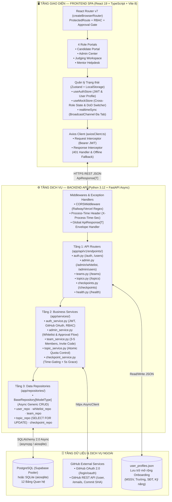
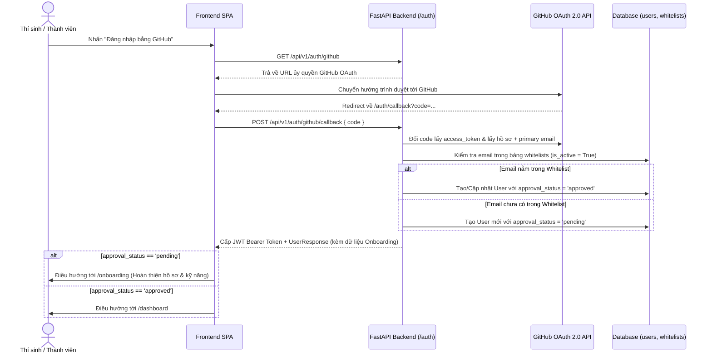

# 🏛️ Tài liệu Kiến trúc Hệ thống Toàn diện (System Architecture Document)

> **Dự án:** HackFlow9 — Nền tảng Quản lý & Chấm thi Hackathon Khép kín  
> **Phiên bản:** 1.0.0  
> **Cập nhật lần cuối:** 15/10/2026  
> **Mã nguồn:** `backend/` (FastAPI 3-Tier) · `frontend/` (React 19 + TypeScript + Vite 8)

---

## 1. Tổng quan Kiến trúc (Executive Overview)

**HackFlow9** được thiết kế theo kiến trúc **Client–Server phân tách độc lập (Decoupled Full-Stack Architecture)** kết hợp mô hình **3 tầng (3-Tier Layered Architecture)** ở phía Backend và **Reactive Dual-Store SPA** ở phía Frontend. Hệ thống giải quyết trọn vẹn vòng đời một kỳ thi Hackathon học thuật qua **4 cổng vai trò (Role Portals)**:
1. **Candidate Portal (`candidate`)**: Đăng ký/Onboarding hồ sơ & kỹ năng, ghép đội bằng mã mời 6 ký tự, chuyển quyền Đội trưởng, đăng ký đề tài giới hạn quota, nộp bài theo Checkpoint Time-gated (đóng băng GitHub Commit SHA), gửi Ticket hỏi Mentor và theo dõi Bảng xếp hạng.
2. **Admin Center (`admin`)**: Quản trị cấu hình cuộc thi, quản lý danh sách Whitelist email, xét duyệt hồ sơ thí sinh (`pending` → `approved`/`rejected`), quản lý đề tài/quota, cấu hình mốc thời gian Checkpoint, thiết lập Barem tiêu chí chấm (`RubricCriteria`), phân công Mentor/Giám khảo và công bố kết quả.
3. **Judging Workspace (`judge`)**: Giao diện chấm điểm chia đôi màn hình (Split-Screen) đối chiếu bài nộp/mã Commit SHA với thanh trượt chấm điểm theo trọng số Rubric, hỗ trợ chế độ ẩn danh đội thi (Blind Judging).
4. **Mentor Helpdesk (`mentor`)**: Tiếp nhận, phân loại và phản hồi Ticket hỗ trợ của các đội thi theo quy trình 3 trạng thái (`open` → `in_progress` → `resolved`), theo dõi tiến độ các đội được phân công.

---

## 2. Sơ đồ Kiến trúc Tổng thể (System Topology)



---

## 3. Kiến trúc Backend Chi tiết (FastAPI 3-Tier Architecture)

### 3.1. Cấu trúc Thư mục Backend (`backend/`)
```text
backend/
├── app/
│   ├── api/
│   │   ├── deps.py                      # FastAPI Dependencies: get_current_user, require_approved, require_role
│   │   └── v1/
│   │       ├── router.py                # Định tuyến tổng hợp tiền tố /api/v1
│   │       └── endpoints/
│   │           ├── auth.py              # Đăng nhập, Đăng ký, GitHub OAuth, Hồ sơ (/auth/*, /users/profile)
│   │           ├── admin.py             # Quản lý Whitelist & Phê duyệt thí sinh (/admin/*)
│   │           ├── teams.py             # Tạo đội, Tham gia bằng mã mời, Đội của tôi (/teams/*)
│   │           ├── topics.py            # Danh sách đề tài, Chọn đề tài nguyên tử, Hủy đề tài (/topics/*)
│   │           ├── checkpoints.py       # Quản lý Checkpoint Time-gated & Kiểm tra cổng mở (/checkpoints/*)
│   │           ├── health.py            # Liveness & Readiness DB check (/health, /health/db)
│   │           └── example.py           # Endpoint mẫu kiểm증 chuẩn ApiResponse Envelope
│   ├── core/
│   │   ├── config.py                    # Pydantic BaseSettings đọc biến môi trường & chuẩn hóa DATABASE_URL
│   │   ├── database.py                  # AsyncEngine, AsyncSessionLocal, get_db transaction lifecycle
│   │   ├── security.py                  # Mã hóa SHA-256 salted password & ký/giải mã JWT (HS256)
│   │   └── exceptions.py                # Hệ thống AppException & Global Exception Handlers
│   ├── models/                          # 12 SQLAlchemy 2.0 Declarative Models kế thừa BaseModel
│   ├── repositories/                    # Tầng truy xuất CSDL bất đồng bộ (AsyncSession)
│   ├── schemas/                         # Pydantic v2 Request/Response DTOs & ApiResponse[T]
│   ├── services/                        # Tầng xử lý quy tắc nghiệp vụ Hackathon
│   └── main.py                          # App Factory, Lifespan Auto-Schema/Seed, CORS Middleware
├── migrations/                          # Alembic schema migrations (001_initial_schema, 002_add_whitelists)
├── tests/                               # Bộ 72 bài kiểm thử tích hợp (Pytest + httpx AsyncClient)
├── railway.json & Procfile              # Cấu hình triển khai Cloud trên Railway
└── requirements.txt                     # Danh sách thư viện Python 3.12
```

### 3.2. Trách nhiệm Từng Tầng trong Mô hình 3-Tier
1. **Tầng 1 — Presentation / Router Layer (`app/api/v1/endpoints/`)**:
   - Tiếp nhận HTTP Request, kiểm tra tính hợp lệ dữ liệu đầu vào bằng **Pydantic v2 Schemas**.
   - Thực thi kiểm tra xác thực & phân quyền qua hệ thống Dependency Injection trong [`app/api/deps.py`](../../backend/app/api/deps.py):
     - `get_current_user`: Giải mã Bearer JWT Token, truy vấn `User` từ DB và kiểm tra `is_active`.
     - `require_approved`: Chặn thí sinh có `approval_status != 'approved'` thực hiện các tác vụ thi đấu (trả về mã lỗi `ACCOUNT_NOT_APPROVED` - HTTP 403).
     - `require_role(*allowed_roles)`: Kiểm soát truy cập theo vai trò RBAC (`admin`, `judge`, `mentor`, `candidate`).
   - Đóng gói kết quả trả về theo định dạng chuẩn `ApiResponse[T]`.
2. **Tầng 2 — Business Logic / Service Layer (`app/services/`)**:
   - Chứa toàn bộ luật nghiệp vụ cốt lõi của cuộc thi Hackathon, hoàn toàn độc lập với giao thức HTTP.
   - Phát sinh các ngoại lệ nghiệp vụ tường minh (`BadRequestException`, `ForbiddenException`, `NotFoundException`, `ConflictException`) kèm `error_code` chuẩn hóa.
3. **Tầng 3 — Data Access / Repository Layer (`app/repositories/`)**:
   - Kế thừa từ lớp cơ sở [`BaseRepository[ModelType]`](../../backend/app/repositories/base.py) cung cấp các thao tác bất đồng bộ chuẩn (`get_by_id`, `get_multi`, `count`, `create`, `update`, `delete`).
   - Quản lý giao dịch nguyên tử (Atomic Transaction): Toàn bộ thay đổi trong một request chia sẻ cùng một `AsyncSession` từ dependency `get_db()`, tự động `commit()` khi hoàn tất hoặc `rollback()` nếu phát sinh bất kỳ ngoại lệ nào.

---

## 4. Chuẩn hóa Giao tiếp API & Xử lý Ngoại lệ (API Envelope Pattern)

Mọi phản hồi từ Backend (kể cả lỗi hệ thống 500 hay lỗi validation 422 của FastAPI) đều được chuẩn hóa qua [`app/schemas/response.py`](../../backend/app/schemas/response.py) và [`app/core/exceptions.py`](../../backend/app/core/exceptions.py):

```json
{
  "success": true,
  "data": { ... },
  "message": "Thông báo kết quả thao tác bằng tiếng Việt rõ ràng",
  "error_code": null
}
```

Khi xảy ra lỗi, Global Exception Handler bắt giữ và trả về cấu trúc đồng nhất:
```json
{
  "success": false,
  "data": null,
  "message": "Đề tài 'AI tạo sinh trong Y tế' đã đủ số lượng đội đăng ký tối đa (5/5).",
  "error_code": "TOPIC_FULL"
}
```

---

## 5. Các Cơ chế Kỹ thuật Trọng tâm (Core Technical Mechanisms)

### 5.1. Luồng Xác thực Kép & Tự động Phê duyệt qua Whitelist (HF-19)


### 5.2. Chống Tranh chấp Đồng thời khi Đăng ký Đề tài (Atomic Quota Locking - HF-21)
Khi nhiều đội trưởng cùng bấm chọn một đề tài chỉ còn 1 slot cuối cùng tại cùng một thời điểm:
- [`TopicService.select_topic`](../../backend/app/services/topic_service.py) gọi [`topic_repo.get_by_id_for_update(db, topic_id)`](../../backend/app/repositories/topic_repo.py).
- Câu lệnh SQL sinh ra sử dụng khóa dòng bi quan `SELECT ... FROM topics WHERE id = :id FOR UPDATE`.
- Giao dịch thứ hai buộc phải đợi giao dịch thứ nhất cập nhật `current_teams = current_teams + 1` và `commit()` xong mới được đọc giá trị `current_teams`. Nếu lúc đó `current_teams >= max_teams`, giao dịch thứ hai lập tức nhận lỗi `409 Conflict (TOPIC_FULL)`, đảm bảo tuyệt đối không bao giờ vượt quá hạn ngạch (`current_teams <= max_teams`).

### 5.3. Kiểm soát Cổng Nộp bài theo Thời gian Server (Time-Gated Checkpoints - HF-32)
Tại [`CheckpointService`](../../backend/app/services/checkpoint_service.py):
- Mọi kiểm tra đóng/mở cổng nộp bài đều lấy thời gian thực chuẩn UTC tại máy chủ (`datetime.now(timezone.utc)`), không phụ thuộc vào đồng hồ trình duyệt của thí sinh.
- Hỗ trợ **Thời gian ân hạn độ trễ mạng (`grace_period_seconds`, mặc định `5 giây`)**:
  $$\text{Thời điểm khóa thực tế (Effective Deadline)} = \text{deadline} + \text{grace\_period\_seconds}$$
- Trạng thái cửa sổ Checkpoint được tính toán động thành 4 trạng thái: `upcoming` (chưa tới `start_time`), `open` (đang mở), `closed` (đã quá hạn kèm ân hạn), hoặc `inactive` (BTC tạm khóa).

---

## 6. Kiến trúc Frontend Chi tiết (React + TypeScript + Vite)

### 6.1. Cấu trúc Thư mục Frontend (`frontend/src/`)
```text
frontend/src/
├── api/
│   ├── axiosClient.ts                   # Axios instance, tự động gắn JWT & xử lý lỗi 401
│   └── checkpointApi.ts                 # Client gọi API Checkpoint
├── components/
│   ├── ProtectedRoute.tsx               # Bảo vệ route theo trạng thái đăng nhập, phê duyệt & Role
│   ├── Button.tsx, Input.tsx, Modal.tsx # Bộ UI Components chuẩn Design System Dark Mode
│   └── common/                          # CountdownTimer, StatCard, RaceConditionModal, RbacForbiddenModal...
├── layouts/
│   └── MainLayout.tsx                   # Bố cục chính: Sidebar động theo Role, Header, DoD Role/Member Switcher
├── pages/
│   ├── LoginPage.tsx                    # Đăng nhập hợp nhất (Local Alias/Email + GitHub OAuth)
│   ├── AuthCallback.tsx                 # Xử lý mã trả về từ GitHub OAuth 2.0
│   ├── OnboardingPage.tsx               # Hồ sơ cá nhân & Onboarding (MSSV, Trường, SĐT, Kỹ năng, Live Preview)
│   ├── TeamsPage.tsx                    # Quản lý Đội thi, Mã mời, Chuyển quyền Đội trưởng, Mời rời đội
│   ├── DashboardPage.tsx                # Bảng điều khiển tổng quan của Thí sinh
│   ├── candidate/                       # Đề tài, Checkpoint, Nộp bài Chung kết, Bảng xếp hạng, Ticket
│   ├── admin/                           # 11 trang quản trị dành cho Ban Tổ Chức (Admin Center)
│   ├── judge/                           # 4 trang chấm thi (Dashboard, Split-Screen Rubric, Đề tài, Kết quả)
│   └── mentor/                          # 4 trang cố vấn (Dashboard, Xử lý Ticket, Đội phụ trách, Tiến độ)
├── store/
│   ├── useAuthStore.ts                  # Lưu trữ phiên đăng nhập (User + JWT Token) đồng bộ localStorage
│   ├── useMockStore.ts                  # Kho dữ liệu tương tác đa vai trò (Teams, Topics, Tickets, Evaluations)
│   └── realtimeSync.ts                  # Đồng bộ trạng thái tức thời giữa nhiều tab trình duyệt
└── App.tsx                              # Định nghĩa toàn bộ bảng định tuyến (Router) cho 4 vai trò
```

### 6.2. Quản lý Phân quyền Đội trưởng & Đồng bộ Hồ sơ trên Frontend
1. **Phân quyền Đội trưởng động (`TeamsPage.tsx`)**:
   - Quyền Đội trưởng (`isLeader`) được tính toán trực tiếp từ thành viên đang đăng nhập (`selfMember.role === 'leader'`).
   - Chỉ khi `isLeader === true`, giao diện mới hiển thị các nút **Chỉnh sửa thông tin đội**, **Chuyển quyền Đội trưởng (`Crown`)** và **Mời thành viên rời khỏi đội (`UserX`)**.
   - Ngay khi Đội trưởng xác nhận chuyển quyền cho thành viên khác, vai trò giữa hai người được hoán đổi tức thời trong state và `localStorage` (`hackflow_team_details_v2`), các nút quản trị lập tức ẩn đi đối với người vừa nhường quyền.
   - Ràng buộc bảo vệ đội: Đội trưởng không thể bấm "Rời khỏi đội" khi đội vẫn còn thành viên khác mà bắt buộc phải chuyển quyền Đội trưởng trước.
2. **Đồng bộ Hồ sơ & Kỹ năng (`OnboardingPage.tsx`)**:
   - Dùng chung cho cả hai đường dẫn `/onboarding` (thí sinh mới) và `/profile` (cập nhật hồ sơ cá nhân).
   - Khi lưu hồ sơ, dữ liệu (`fullName`, `studentId`, `university`, `phone`, `skills`) được gửi lên `POST /api/v1/users/profile` (lưu vào DB + `user_profiles.json`), đồng thời đồng bộ vào `useAuthStore`, `useMockStore` và danh sách thành viên đội thi (`hackflow_team_details_v2`).
   - Trang bị cơ chế **Offline / Network Fallback**: Nếu mất kết nối tới máy chủ Backend, hệ thống tự động lưu cục bộ vào `localStorage` để không làm gián đoạn trải nghiệm người dùng.

---

## 7. Kiến trúc Triển khai Cloud (Deployment Architecture)

Hệ thống hỗ trợ triển khai linh hoạt trên hạ tầng Cloud hiện đại:
- **Backend (`backend/railway.json`, `backend/Procfile`, `render.yaml`)**:
  - Chạy trên **Railway** (hoặc Render) với Python 3.12 và ASGI server `uvicorn app.main:app --host 0.0.0.0 --port $PORT`.
  - Khi khởi động (`lifespan` trong [`app/main.py`](../../backend/app/main.py)), hệ thống tự động kiểm tra và khởi tạo toàn bộ 12 bảng CSDL (`Base.metadata.create_all`) đồng thời seed sẵn bộ tài khoản mẫu cho cả 4 vai trò.
  - Cấu hình `statement_cache_size = 0` trong `asyncpg` để tương thích hoàn toàn với **Supabase Connection Pooler (IPv4 port 6543/5432)**.
- **Frontend (`frontend/railway.json`, `frontend/nixpacks.toml`, `frontend/vercel.json`)**:
  - Hỗ trợ triển khai trên cả **Railway** (sử dụng Node.js 22 qua `nixpacks.toml`) và **Vercel** (hỗ trợ SPA Rewrite qua `vercel.json` để tránh lỗi 404 khi tải lại các đường dẫn con).
