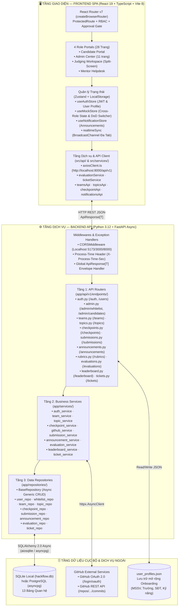

# 🏛️ Tài liệu Kiến trúc Hệ thống Toàn diện (System Architecture Document)

> **Dự án:** HackFlow — Nền tảng Quản lý & Chấm thi Hackathon Khép kín  
> **Phiên bản:** 2.0.0 (Hoàn thiện toàn bộ 4 Sprint — Local Development Edition)  
> **Cập nhật lần cuối:** 19/10/2026  
> **Mã nguồn:** `backend/` (FastAPI 3-Tier Async) · `frontend/` (React 19 + TypeScript + Vite 8)

---

## 1. Tổng quan Kiến trúc (Executive Overview)

**HackFlow** được thiết kế theo kiến trúc **Client–Server phân tách độc lập (Decoupled Full-Stack Architecture)** kết hợp mô hình **3 tầng (3-Tier Layered Architecture)** ở phía Backend và **Reactive Dual-Store SPA** ở phía Frontend. Hệ thống giải quyết trọn vẹn vòng đời một kỳ thi Hackathon học thuật qua **4 cổng vai trò (Role Portals)**:
1. **Candidate Portal (`candidate`)**: Đăng ký/Onboarding hồ sơ & kỹ năng, ghép đội bằng mã mời 6 ký tự, chuyển quyền Đội trưởng, đăng ký đề tài giới hạn quota, nộp bài theo Checkpoint Time-gated (đóng băng GitHub Commit SHA), nộp bài Chung kết, gửi Ticket hỏi Mentor và theo dõi Bảng xếp hạng.
2. **Admin Center (`admin`)**: Quản trị cấu hình cuộc thi, quản lý danh sách Whitelist email, xét duyệt hồ sơ thí sinh (`pending` → `approved`/`rejected`), quản lý đề tài/quota, cấu hình mốc thời gian Checkpoint, thiết lập Barem tiêu chí chấm (`RubricCriteria`), phát thông báo toàn hệ thống (`Announcement`), phân công Mentor/Giám khảo và công bố kết quả.
3. **Judging Workspace (`judge`)**: Giao diện chấm điểm chia đôi màn hình (Split-Screen) đối chiếu bài nộp/mã Commit SHA với thanh trượt chấm điểm theo trọng số Rubric, hỗ trợ chế độ ẩn danh đội thi (Blind Judging `ĐỘI-ANON-XX`), khóa bảng điểm (`submitted`) và cảnh báo chênh lệch điểm số (`> 15.0` điểm).
4. **Mentor Helpdesk (`mentor`)**: Tiếp nhận, phân loại và phản hồi Ticket hỗ trợ của các đội thi theo quy trình máy trạng thái (`open` → `in_progress` → `resolved` → `closed`), hỗ trợ chuyển giao (`escalate`) lên Admin và đảm bảo cô lập quyền truy cập khỏi phân hệ chấm điểm.

---

## 2. Sơ đồ Kiến trúc Tổng thể (System Topology)



---

## 3. Kiến trúc Backend Chi tiết (FastAPI 3-Tier Architecture)

### 3.1. Cấu trúc Thư mục Backend (`backend/`)
```text
backend/
├── app/
│   ├── api/
│   │   ├── deps.py                      # FastAPI Dependencies: get_current_user, require_approved, require_role
│   │   └── v1/
│   │       ├── router.py                # Định tuyến tổng hợp tiền tố /api/v1 (12 phân hệ)
│   │       └── endpoints/
│   │           ├── auth.py              # Đăng nhập, Đăng ký, GitHub OAuth, Hồ sơ (/auth/*, /users/profile)
│   │           ├── admin.py             # Quản lý Whitelist & Phê duyệt thí sinh (/admin/*)
│   │           ├── teams.py             # Tạo đội, Tham gia bằng mã mời, Đội của tôi (/teams/*)
│   │           ├── topics.py            # Danh sách đề tài, Chọn đề tài nguyên tử, Hủy đề tài (/topics/*)
│   │           ├── checkpoints.py       # Quản lý Checkpoint Time-gated & Kiểm tra cổng mở (/checkpoints/*)
│   │           ├── submissions.py       # Nộp bài đóng băng GitHub Commit SHA, Rollback & Audit Log (/submissions/*)
│   │           ├── announcements.py     # Quản lý thông báo chung của BTC (/announcements/*)
│   │           ├── rubrics.py           # Quản lý Barem tiêu chí chấm điểm (/rubrics/*)
│   │           ├── evaluations.py       # Chấm điểm Blind Judging & Lưu nháp/Khóa điểm (/evaluations/*)
│   │           ├── leaderboard.py       # Tổng hợp bảng xếp hạng, Cảnh báo lệch điểm & Công bố (/leaderboard/*)
│   │           ├── tickets.py           # Hệ thống Helpdesk Ticket hỗ trợ 4 trạng thái (/tickets/*)
│   │           ├── health.py            # Liveness & Readiness DB check (/health, /health/db)
│   │           └── example.py           # Endpoint mẫu kiểm chứng chuẩn ApiResponse Envelope
│   ├── core/
│   │   ├── config.py                    # Pydantic BaseSettings đọc biến môi trường Local (.env)
│   │   ├── database.py                  # AsyncEngine, AsyncSessionLocal, get_db transaction lifecycle
│   │   ├── security.py                  # Mã hóa SHA-256 salted password & ký/giải mã JWT (HS256)
│   │   └── exceptions.py                # Hệ thống AppException & Global Exception Handlers
│   ├── models/                          # SQLAlchemy 2.0 Declarative Models kế thừa BaseModel
│   ├── repositories/                    # Tầng truy xuất CSDL bất đồng bộ (AsyncSession)
│   ├── schemas/                         # Pydantic v2 Request/Response DTOs & ApiResponse[T]
│   ├── services/                        # Tầng xử lý quy tắc nghiệp vụ Hackathon
│   └── main.py                          # App Factory, Lifespan Auto-Schema/Seed, CORS Middleware
├── migrations/                          # Alembic schema migrations (001 -> 004)
├── tests/                               # Bộ 95 bài kiểm thử tự động (Pytest + httpx AsyncClient)
├── main.py                              # Entrypoint chạy trực tiếp uvicorn main:app hoặc python main.py
└── requirements.txt                     # Danh sách thư viện Python 3.12
```

### 3.2. Trách nhiệm Từng Tầng trong Mô hình 3-Tier
1. **Tầng 1 — Presentation / Router Layer (`app/api/v1/endpoints/`)**:
   - Tiếp nhận HTTP Request, kiểm tra tính hợp lệ dữ liệu đầu vào bằng **Pydantic v2 Schemas**.
   - Thực thi kiểm tra xác thực & phân quyền qua hệ thống Dependency Injection trong `app/api/deps.py`:
     - `get_current_user`: Giải mã Bearer JWT Token, truy vấn `User` từ DB và kiểm tra `is_active`.
     - `require_approved`: Chặn thí sinh có `approval_status != 'approved'` thực hiện các tác vụ thi đấu (trả về mã lỗi `ACCOUNT_NOT_APPROVED` - HTTP 403).
     - `require_role(*allowed_roles)`: Kiểm soát truy cập theo vai trò RBAC (`admin`, `judge`, `mentor`, `candidate`).
   - Đóng gói kết quả trả về theo định dạng chuẩn `ApiResponse[T]`.
2. **Tầng 2 — Business Logic / Service Layer (`app/services/`)**:
   - Chứa toàn bộ luật nghiệp vụ cốt lõi của cuộc thi Hackathon, hoàn toàn độc lập với giao thức HTTP.
   - Phát sinh các ngoại lệ nghiệp vụ tường minh (`BadRequestException`, `ForbiddenException`, `NotFoundException`, `ConflictException`, `UnprocessableEntityException`) kèm `error_code` chuẩn hóa.
3. **Tầng 3 — Data Access / Repository Layer (`app/repositories/`)**:
   - Quản lý truy vấn SQLAlchemy 2.0 bất đồng bộ (`AsyncSession`).
   - Quản lý giao dịch nguyên tử (Atomic Transaction): Toàn bộ thay đổi trong một request chia sẻ cùng một `AsyncSession` từ dependency `get_db()`, tự động `commit()` khi hoàn tất hoặc `rollback()` nếu phát sinh bất kỳ ngoại lệ nào.

---

## 4. Các Cơ chế Kỹ thuật Trọng tâm (Core Technical Mechanisms)

### 4.1. Chống Tranh chấp Đồng thời khi Đăng ký Đề tài (Atomic Quota Locking - HF-21)
Khi nhiều đội trưởng cùng bấm chọn một đề tài chỉ còn 1 slot cuối cùng tại cùng một thời điểm:
- `TopicService.select_topic` gọi `topic_repo.get_by_id_for_update(db, topic_id)` kết hợp khóa bất đồng bộ.
- Câu lệnh SQL sinh ra sử dụng khóa dòng bi quan `SELECT ... FROM topics WHERE id = :id FOR UPDATE`.
- Giao dịch thứ hai buộc phải đợi giao dịch thứ nhất cập nhật `current_teams = current_teams + 1` và `commit()` xong mới được đọc giá trị `current_teams`. Nếu lúc đó `current_teams >= max_teams`, giao dịch thứ hai lập tức nhận lỗi `409 Conflict (TOPIC_FULL)`.

### 4.2. Kiểm soát Cổng Nộp bài theo Thời gian Server & Đóng băng GitHub Commit SHA (HF-32, HF-33, HF-34)
- **Time-Gated Checkpoints**: Mọi kiểm tra đóng/mở cổng nộp bài đều lấy thời gian thực chuẩn UTC tại máy chủ (`datetime.now(timezone.utc)`), hỗ trợ thời gian ân hạn độ trễ mạng (`grace_period_seconds = 5s`):
  $$\text{Effective Deadline} = \text{deadline} + 5\text{s}$$
- **GitHub Commit SHA Freeze**: Khi thí sinh gửi URL kho mã nguồn GitHub (`POST /api/v1/submissions`), `GitHubService` tự động truy vấn GitHub REST API để lấy mã băm `commit_sha` mới nhất tại thời điểm nộp và đóng băng vào bảng `submissions` kèm bản ghi kiểm toán `audit_logs`, đồng thời hỗ trợ cơ chế `rollback` về phiên bản bài nộp trước đó khi cổng Checkpoint còn mở.

### 4.3. Động cơ Chấm điểm Rubric Trọng số, Blind Judging & Bảng xếp hạng (HF-42, HF-43)
- **Blind Judging (`GET /api/v1/evaluations/submissions`)**: Tự động ẩn danh tên đội thi thành mã định danh `ĐỘI-ANON-XX` đối với Giám khảo nhằm đảm bảo tính khách quan tuyệt đối.
- **Tính điểm theo trọng số & Khóa bảng điểm (`POST /api/v1/evaluations`)**: Điểm tổng của mỗi giám khảo được tính tự động từ điểm từng tiêu chí nhân với trọng số chuẩn hóa:
  $$\text{Total Score} = \sum_{i=1}^{n} \left( \frac{\text{score}_i}{\text{max\_score}_i} \times \text{weight}_i \right)$$
  Khi giám khảo gửi trạng thái `status = "submitted"`, phiếu chấm bị khóa vĩnh viễn (`EVALUATION_ALREADY_SUBMITTED` nếu cố sửa lại).
- **Tổng hợp Leaderboard & Cảnh báo lệch điểm (`GET /api/v1/leaderboard`)**: Tự động tính điểm trung bình từ các phiếu đã `submitted`, phát hiện chênh lệch điểm lớn giữa các giám khảo ($\max - \min > 15.0 \Rightarrow \text{has\_discrepancy = true}$), áp dụng quy tắc phân định thắng thua (`tie-breaker`) và kiểm soát trạng thái công bố kết quả (`is_result_published`).

### 4.4. Máy Trạng Thái Helpdesk Support Ticket & Cô lập Quyền Mentor (HF-37, HF-40, HF-47)
- Quản lý vòng đời Ticket qua 4 trạng thái: `open` $\rightarrow$ `in_progress` (`accept` / `update_response` / `escalate`) $\rightarrow$ `resolved` (`resolve` bắt buộc có `response`) $\rightarrow$ `closed` (`close` hoặc `reopen` trong vòng 48 giờ).
- **Cô lập dữ liệu (RBAC Isolation)**: Thí sinh chỉ xem được ticket của đội mình; Mentor chỉ xem được ticket đang chờ tiếp nhận (`open` & `assigned_to IS NULL`) hoặc ticket do chính mình phụ trách; Giám khảo bị chặn hoàn toàn khỏi API Ticket (`403 FORBIDDEN_ROLE`); Mentor bị chặn hoàn toàn khỏi API Chấm điểm (`403 FORBIDDEN_ROLE`).

---

## 5. Vận hành & Kiểm thử Môi trường Cục bộ (Local Execution Architecture)

Hệ thống được cấu hình tối ưu để chạy hoàn toàn độc lập trên máy cá nhân (Localhost) mà không phụ thuộc vào hạ tầng Cloud bên ngoài:
- **Backend Local (`http://localhost:8000`)**:
  - Tự động khởi tạo cơ sở dữ liệu SQLite cục bộ (`backend/hackflow.db`) và seed sẵn tài khoản mẫu cho cả 4 vai trò (`admin`, `judge`, `mentor`, `candidate`), 5 đề tài mẫu và đội thi `CyberSamurai` ngay khi khởi chạy `uvicorn main:app --reload --port 8000` (hoặc `uvicorn app.main:app --reload --port 8000`).
  - Bộ kiểm thử tự động `pytest` gồm **95 test cases** sử dụng SQLite In-Memory (`sqlite+aiosqlite:///file:testmem?mode=memory`) đảm bảo tốc độ kiểm thử nhanh và cô lập 100%.
- **Frontend Local (`http://localhost:5173`)**:
  - Kết nối trực tiếp tới `http://localhost:8000/api/v1` qua `axiosClient.ts`.
  - Trang bị cơ chế **Local Offline Fallback & Cross-Tab Realtime Sync (`BroadcastChannel`)** giúp kiểm thử liền mạch mọi luồng tương tác giữa 4 vai trò ngay trên nhiều tab trình duyệt cục bộ.
